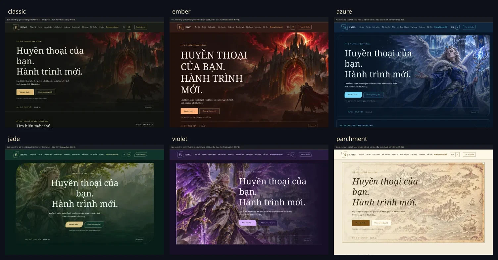
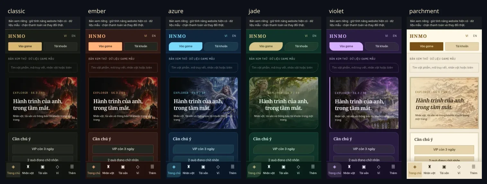
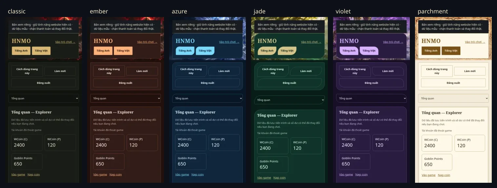

# Global website themes / Giao diện chung cho website

This is the first additive website foundation. Existing pages, feature IDs, account modules, authentication, VIP and payment handlers remain. The approved profile design stays in PR #277 and is retained in the private review Site. It is not replaced by this CSS change.

Đây là phần nền tảng bổ sung đầu tiên. Giữ các trang, mã mục, mô-đun tài khoản, đăng nhập, VIP và xử lý thanh toán hiện có. Bản profile đã duyệt ở PR #277 vẫn được giữ trong bản xem riêng.

## Host settings / Cài đặt của host

- Admin → Plug-ins → Website → Website theme: ONE saved choice for all visitors and all public pages. A game world or account never selects a different skin. Save and reload open pages. Existing enum IDs are unchanged.
- Admin → Plug-ins → Brand (the existing game-name plug-in, same identity): name and community links remain; optional logo, accent, background, panel and text colors are added. Empty overrides use the selected theme. New fields and validation messages have EN, VI, DE and zh-CN resources.
- Admin → Plug-ins → Website → Giao diện website: host chọn một lần cho mọi người và toàn bộ trang; đổi thế giới hoặc tài khoản không đổi giao diện. Lưu rồi tải lại các trang đang mở.
- Admin → Plug-ins → Thương hiệu: giữ tên và liên kết cộng đồng; thêm logo và màu nhấn/nền/khung/chữ. Để trống dùng màu của theme. Nhãn, mô tả và lỗi kiểm tra mới có đủ bốn ngôn ngữ.

| Skin | Layout / Bố cục |
|---|---|
| Classic | Additional dark/gold direction from the owner prompt; original ID0 retained. / Bản tối/vàng bổ sung theo prompt; giữ mã0. |
| Ember | Wide fortress hero, uppercase headings, angular panels, left account navigation. / Thành trì rộng, tiêu đề in hoa, khung góc cạnh, menu trái. |
| Azure | Framed ice-citadel hero, curved cut corners, horizontal account navigation. / Thành băng trong khung, góc cắt cong, menu ngang. |
| Jade | Centered sanctuary hero, leaf-shaped frames and centered actions. / Thánh địa căn giữa, khung dáng lá, hành động căn giữa. |
| Violet | Sky-fortress art on the left, hero text and account navigation on the right. / Pháo đài thiên không bên trái, nội dung/menu tài khoản bên phải. |
| Parchment | Light continent atlas, double borders, italic serif headings and ledger navigation. / Bản đồ lục địa sáng, viền kép, tiêu đề serif nghiêng, bố cục sổ. |

## Review images / Ảnh xem trước

All records in the private preview and these screenshots are fictional. Native feature modules are retained; unavailable sample services continue to display their original availability messages. / Dữ liệu và ảnh trong bản xem là mẫu; giữ mô-đun thật và thông báo dịch vụ chưa có dữ liệu mẫu.

The screenshot folder has each of seven pages at390px and1440px for every skin: home, account, approved profile, game login, top-up, guide and calculator. Tables scroll within their card. Phone controls use a single shared account-language pair, balanced action rows and44px minimum targets. / Có ảnh từng trang ở390px và1440px cho cả sáu theme; bảng cuộn trong khung, nút điện thoại thống nhất và bộ ngôn ngữ tài khoản không lặp.

## Private review / Bản xem riêng

https://hnmo-account-hub-preview.beautifulclock2.chatgpt.site/host-preview.html

The owner-only review selector is deliberately a browser-local visual choice, not a live admin backend. In production the persisted host configuration and public settings endpoint are authoritative; player pages have no theme picker. The Site keeps the existing owner-only audience and the approved profile at /account-profile-preview.html?view=profile. No real payment, SMTP, registration or gameplay service is connected to this Site. / Bộ chọn riêng chỉ phục vụ xem giao diện trong trình duyệt, không phải cấu hình máy chủ. Bản chạy thật dùng cấu hình đã lưu của host. Người chơi không chọn theme. Không có giao dịch hoặc máy chủ game thật trong bản xem.

## Existing data to extend / Dữ liệu đã có để bổ sung

- WebsiteController already exposes per-running-server/world EXP, master EXP, drop/zen rates, level caps, classes, maps and mini-game definitions. WebsiteDetailsController supplies schedule/rankings/drop details. Extend these rather than inventing static rate cards.
- WebsiteItemsController exposes definition overrides, not the population of carried items; an inventory/search API still needs an authorized projection.
- ActivityLog already has Trade, Drop, Pickup, ChaosMix, NpcBuy, NpcSell, PersonalStore, ItemMarket and Administration. Its current append persists synchronously per row. The requested missing events, bounded batch writer and performance test need their separate PR before exposing a public tracker. Never publish private Account/PartnerAccount fields from existing rows.
- DuplicateItems contains serial/case rules; Economy and PlayerRanking already exist. Reuse those, including retention and existing PostgreSQL feature rows. No second log or wallet is introduced here.
- Account API/VIP/missions/calendar/referrals/email/password/gift-box, public market/bank/events and existing payment providers remain. None is switched off or selected by a skin.

API đã có nhiều dữ liệu máy chủ và tính năng tài khoản. Phần tiếp theo phải mở rộng dữ liệu đó, giữ riêng thông tin định danh và không coi API định nghĩa vật phẩm là danh sách vật phẩm người chơi đang giữ. Nhật ký mới, ghi theo lô và kiểm thử hiệu năng chưa thuộc phần giao diện này.

## New host text pairs / Văn bản cấu hình mới

| Key | English | Tiếng Việt |
|---|---|
| Caption | Brand | Thương hiệu |
| Description | The name, logo and colors of your website. Empty colors use the selected theme. These settings apply to the whole website. | Tên, logo và màu sắc website của bạn. Để trống màu để dùng màu của theme. Cấu hình áp dụng cho toàn website. |
| LogoCaption | Website logo | Logo website |
| LogoDescription | An HTTPS image URL or a path on this website, such as /images/logo.png. Empty keeps the text brand. | Đường dẫn ảnh HTTPS hoặc đường dẫn trên website, ví dụ /images/logo.png. Để trống để chỉ hiện tên game. |
| AccentCaption | Accent color | Màu nhấn |
| AccentDescription | Hex color such as #D9B773 for highlights and buttons; empty uses the theme. | Mã màu như #D9B773 cho điểm nhấn và nút; để trống để dùng màu của theme. |
| BackgroundCaption | Background color | Màu nền |
| BackgroundDescription | Website background as #RRGGBB; empty uses the theme. | Màu nền website dạng #RRGGBB; để trống để dùng màu của theme. |
| PanelCaption | Panel color | Màu khung nội dung |
| PanelDescription | Content card background as #RRGGBB; empty uses the theme. | Màu nền khung nội dung dạng #RRGGBB; để trống để dùng màu của theme. |
| TextCaption | Text color | Màu chữ |
| TextDescription | Main text color as #RRGGBB. Choose a color clearly readable against your panels; empty uses the theme. | Màu chữ chính dạng #RRGGBB. Chọn màu dễ đọc trên nền khung nội dung; để trống để dùng màu của theme. |
| ColorValidation | Enter a color as #RRGGBB, such as #D9B773, or leave it empty. | Nhập màu dạng #RRGGBB, ví dụ #D9B773, hoặc để trống. |
| LogoLengthValidation | The logo address must contain at most {1} characters. | Địa chỉ logo không được dài quá {1} ký tự. |
| LogoFormatValidation | Use an HTTPS image address or a path on this website, or leave it empty. | Dùng địa chỉ ảnh HTTPS hoặc đường dẫn trên website này, hoặc để trống. |

See [WEBSITE-FEATURE-PLAN.md](WEBSITE-FEATURE-PLAN.md) for all14 requested slices and remaining implementation. Navigation for new feature routes will ship with those functional pages. This first foundation does not claim the live tracker, all guides, editable legal pages or the complete profile data APIs are finished. / Xem bảng14 phần; liên kết mới đi cùng trang chức năng thật. Chưa coi toàn bộ yêu cầu mới là hoàn tất.
