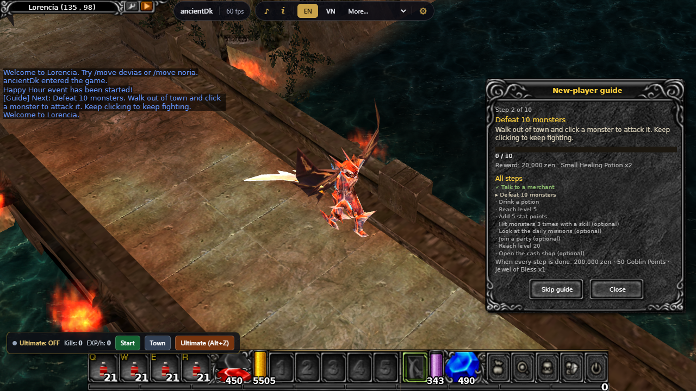
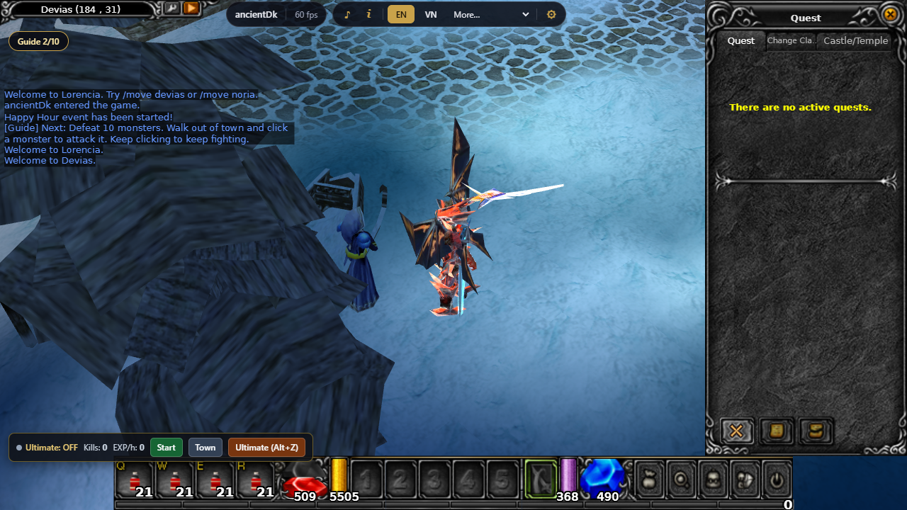
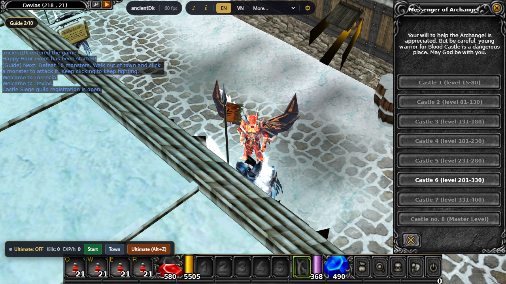
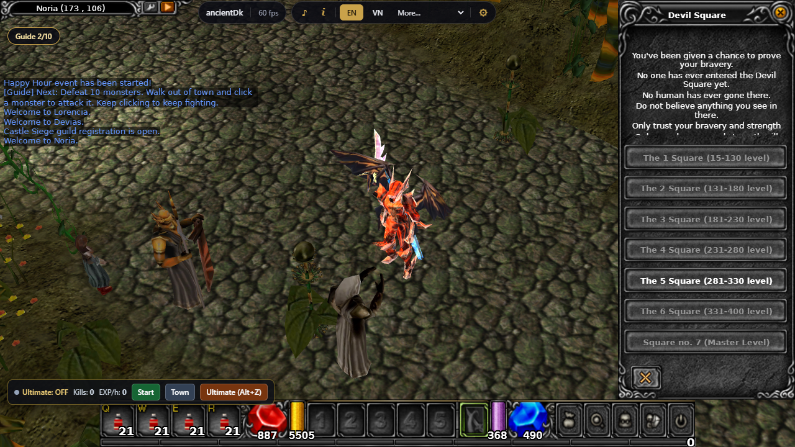
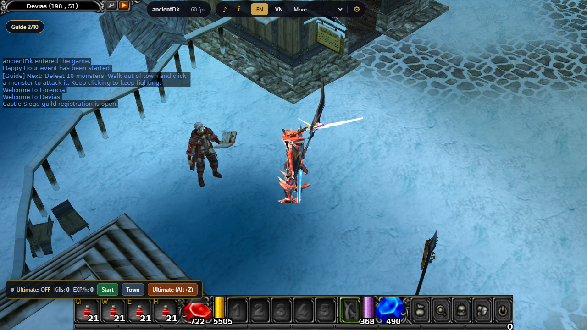
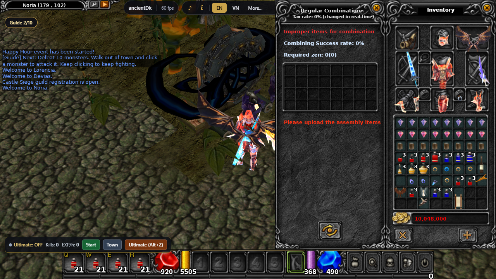
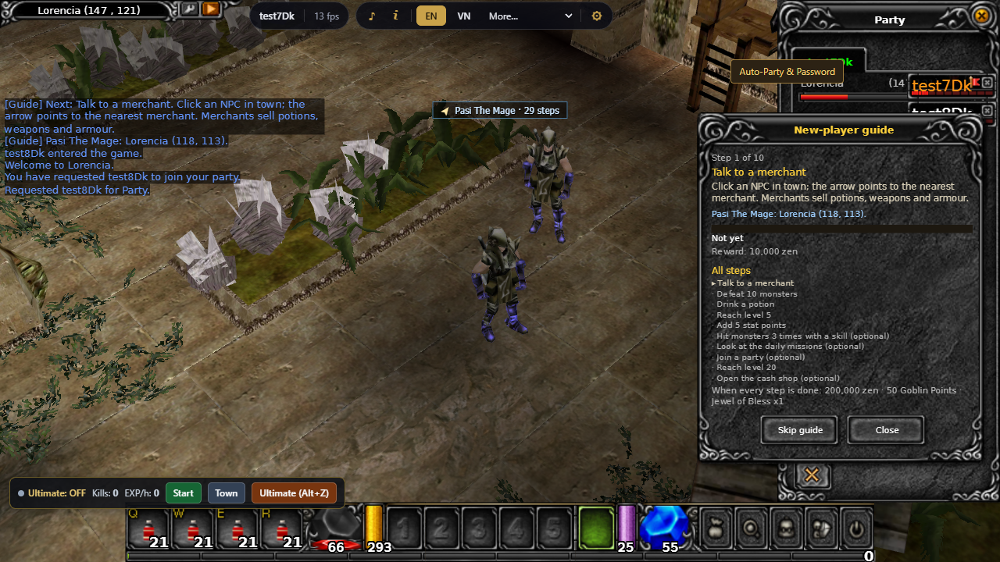
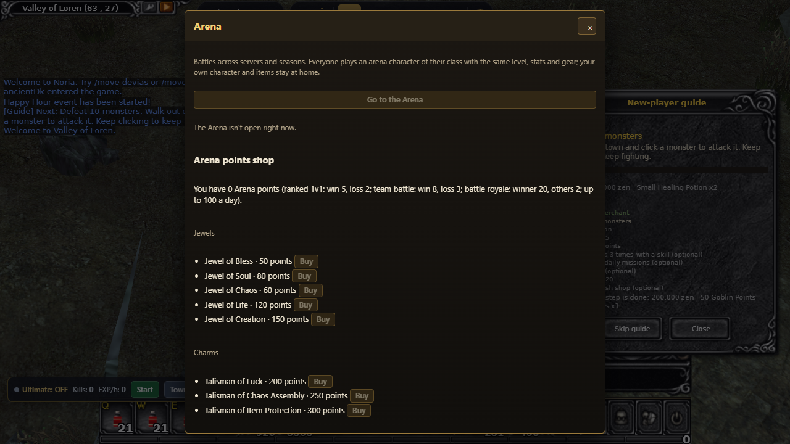
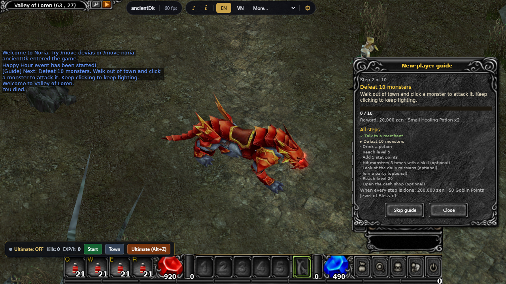

# Season 6 and Season 9 Playtest & Arena Walk Check — 2026-11-22 (Australia/Sydney)

Live browser playtest and verification across Season 6 and Season 9 on the owner's Windows PC, branch `claude/hnmo-main-handover-54co2m` with local draft PRs `#259`–`#275`.

## 1. Automated & Live Gameplay Playtest Summary

All core gameplay areas were verified against the live server and web client (`1280x720`, Chromium WebGL / D3D11 and SwiftShader):

| Gameplay Area | E2E / Live Verification | Result | Notes |
|---|---|---|---|
| **Fighting & Field Spawns** | `combat.spec.ts`, `rage-fighter.spec.ts` (`3/3`), `skill-cast.spec.ts`, `skill-effects.spec.ts` (`9/9`), `new-skills.spec.ts` | **PASS** | Damage numbers, health bars, skill projectiles, Chain Lightning bolts (S6 & S9 `#262`), Dark Side afterimages (`#275`), and field monster respawn anchoring in Lorencia & Noria (`#274`). |
| **Quests** | `quests.spec.ts` (`3/3`) | **PASS** | Tutorial/NPC quest acceptance and quest window (`T`), Sebina the Priest (`235`) in Devias class-change quest, and Lv.250 Elf Soldier trial quest. |
| **Blood Castle / Devil Square / Chaos Castle** | `events.spec.ts` (`1/1`) | **PASS** | Messenger of Archangel (`233`) in Devias opens `blood_castle_enter.rml` (Castle 6 enabled for Lv.330); Charon (`237`) in Noria opens `devil_square_enter.rml` (Square 5 enabled); Chaos Castle entry prompt (`C1 91 04`), Blood Castle timer (`blood_castle_time.rml`), 30s countdown (`hud_status.rml`), and completion reward box (`message_box_view.rml`). |
| **Illusion Temple / Doppelganger / Imperial Guardian** | `events-instance.spec.ts` (`2/2`) | **PASS** | Mirage (`385`) in Devias opens `cursed_temple_enter.rml` (Temple 1 enabled for Lv.220, member counts `C1 BF 03`); Lugard (`540`) opens `doppelganger_enter.rml`; Jerint (`543`) opens `empire_guardian_enter.rml`; live GM `/startit` & `/skipwait` entry verified. |
| **Trade** | `trade.spec.ts` (`1/1`) | **PASS** | Two players (`test3`, `test4`) meet in Lorencia, open the trade window, transfer an item across slots, lock and complete the trade. |
| **Party** | `party.spec.ts` (`1/1`) | **PASS** | Two players (`test7`, `test8`) in Lorencia: `PartyInviteRequest` (`C1 40`), confirmation dialog, HUD party cards (`party_list.rml`), `P` party window (`party_info.rml`) showing map and health bars, and party leave (`C1 43`). |
| **Guild** | `guilds.spec.ts` (`2/2`) | **PASS** | In-game Guild panel (`G`), guild level buff strip, chat notices, and website guild ladder / Castle Siege schedule in English and Vietnamese. |
| **Shops & Inventory / Vault** | `shop.spec.ts` (`1/1`), `inventory.spec.ts` (`4/4`) | **PASS** | Merchant buy/sell, equipment wear/unwear with live 3D character update, and Vault Keeper (`240`) deposit/withdrawal. |
| **Chaos Machine** | `chaos.spec.ts` (`1/1`) | **PASS** | Chaos Goblin (`238`) in Noria opens `mix_inventory.rml` next to `my_inventory.rml` with the combination method menu; Jewel of Bless/Soul placement shows 100% rate and required Zen, combines into Potion of Bless/Soul, deducts Zen, and returns the crafted item to the bag. |
| **Season 9 World & Data** | `season.spec.ts` (`4/4`), `world-season9.test.mjs`, `HNMO.Persistence.Initialization.Tests` (`978 passed, 0 failed`) | **PASS** | Season 9 world walk across Lorencia, Devias, and Noria (`0` page errors); Season 9 shared items (`#268`), 279 Season 9-only items (`#269`), socket options (`#270`), 111 monsters/NPCs (`#271`), and 10 maps/gates (`#272`). |

## 2. Arena Walk Check: What a Real Browser Shows After a Warp into an Arena Battle and After a Respawn

We inspected both the live browser rendering and the client/server packet flow for:
1. warping into an Arena battle (`WarpToAsync` -> `MapChanged` `C3 1C`), and
2. dying and respawning (`RespawnAtAsync` -> `RespawnAfterDeathExtended` `C1 F3 04`).

### 2.1. After a warp into an Arena battle (`WarpToAsync` -> `C3 1C`)

```json
{"mapNumber":30,"heroCell":{"x":63,"y":27},"heroVisible":true,"arenaPanelStillOpen":true,"charactersCount":1}
```

- **Map & character state:** When `ArenaTeams.StartAsync` (or `ArenaGuildWar.StartAsync` / `ArenaRoyale.StartAsync`) warps the fighter to the battle gate (e.g. Red team gate `X: 60..66, Y: 24..30` on Valley of Loren map `30`), `OnlineWorld.mapChanged` sets `changingMap = true`, clears old map characters and ground drops, loads `World31` (`Valley of Loren`), places the hero at `(63, 27)` with `hero.group.visible === true`, and sends `ClientReadyAfterMapChange` (`F3 12`).
- **UI overlay observation:** Because the player had `#hnmo-arena-panel` open to click **Find a team battle** / **Join the battle royale**, `ArenaWindow.handle` updates the panel in place (`arenaPanelStillOpen: true`) rather than closing it automatically when the match starts and warps the player onto the battlefield. The player sees the `#hnmo-arena-panel` modal covering the center of the screen over Valley of Loren until they close it manually (with `Alt+A` or `✕`).
- **Walking after the warp:** Once the panel is closed, clicking the ground (or calling `walkTo({ x: 68, y: 27 })`) walks smoothly across the Valley of Loren terrain toward the center (`88, 27`) with no rubber-banding.

### 2.2. After a respawn (`RespawnAtAsync` -> `C1 F3 04` `RespawnAfterDeathExtended`)

```json
{"dead":false,"heroCell":{"x":63,"y":27},"heroGroupVisible":false,"heroZ":222,"staleCharactersStillInMap":[{"id":4660,"name":"test3Elf","cell":{"x":68,"y":27}}]}
```

A real browser reveals **two client bugs** after a respawn (`C1 F3 04`), neither of which is caught by tests that only assert `!hero.dead` and `hero.cell`:

1. **The hero becomes completely invisible (`hero.group.visible === false`) after respawning (`client/web/src/game/combatEffects.ts:581–655`):**
   - When the hero is killed (`ObjectGotKilled` `C1 17`), `main.ts:1521` calls `deaths.died(dead, ...)` in `DeathEffects`.
   - `DeathEffects.rot()` starts fading all materials on `record.character.group` and sinking `group.position.z` after `DEATH_FADE_START_SECONDS` (`2.0 s`), and after `DEATH_FADE_START_SECONDS + DEATH_FADE_SECONDS` (`3.98 s`) `DeathEffects.vanish()` sets `record.character.group.visible = false`.
   - For monsters and other players, `DeathEffects.update()` cleans up the record when the server removes their `group` from `root` (`!record.character.group.parent`). However, **`online.hero.group.parent` is permanently `root`**, and `DeathEffects` never checks `!record.character.dead` or restores `group.visible`, `materials` opacity, or `sink` when `combat.respawn()` sets `hero.dead = false`!
   - In the Arena (where `TeamRespawnSeconds = 5 s`), `3.98 s` elapses *before* the respawn packet arrives at `5.0 s`, so the hero is already `visible = false` when placed back at the gate `(63, 27)`. Even on normal maps (`3.0 s` respawn delay), `DeathEffects.update()` continues ticking `this.rot()` on the alive hero after respawn and turns `hero.group.visible = false` `0.98 s` after the hero has respawned and started walking!
2. **Stale characters and ground items from the death location remain in the scene (`client/web/src/main.ts:1590–1593`):**
   - On the server, `PlayerMapTransitions.TryRemoveFromCurrentMapAsync` removes the player from the map (`NewBucket = null`) and calls `ClearObservingObjectsListAsync()`. Because `NewBucket` is `null`, `ObserverToWorldViewAdapter.LocateablesOutOfScopeAsync` (`line 156`) intentionally skips sending `ObjectsOutOfScope` (`C1 14`) packets, expecting the client's revival handler to clear its viewport (as the desktop C++ client does in `WSclient.cpp:1479–1480` `ReceiveRevival`: `ClearItems(); ClearCharacters(HeroKey);`).
   - On the web client, `onRespawn` (`client/web/src/main.ts:1590–1593`) only runs:
     ```ts
     onRespawn: async (map, x, y) => {
       if (map !== state.mapNumber) { await loadMap(map); online.world = state.world!; }
       state.hero!.placeAt(x, y);
     },
     ```
     It does **not** call `online.clearCharacters()`, `state.ground?.clear()`, or reset `online.goal = null; online.followId = null;`.
   - As a result, players and monsters near the death site stay frozen at their old coordinates in `online.characters` (blocking `online.spawn()` when they re-enter view because `this.characters.has(id)` is still `true`), and when a Battle Royale fighter dies on Lorencia (map `0`) and respawns via `C1 F3 04` onto the Arena map (`6`), Lorencia's monsters and players remain drawn on top of the Arena map.

## 3. Screenshots

Captured in `docs/screenshots/playtest-2026-11-22/`:

- `01-fighting-lorencia.png` — Live field combat outside Lorencia.
- `02-quests-devias.png` — Quest window (`T`) and Sebina the Priest in Devias.
- `03-events-blood-castle.png` — Messenger of Archangel (`blood_castle_enter.rml`) in Devias.
- `04-events-devil-square.png` — Charon (`devil_square_enter.rml`) in Noria.
- `05-events-illusion-temple.png` — Mirage (`cursed_temple_enter.rml`) in Devias.
- `06-chaos-machine.png` — Chaos Goblin Regular Combination (`mix_inventory.rml`) in Noria.
- `07-party-window.png` — Two-player Party HUD cards and Party window (`party_info.rml`) in Lorencia.
- `08-arena-warp-battle.png` — After warping into an Arena team battle at Valley of Loren (`63, 27`) with `#hnmo-arena-panel` still open.
- `09-arena-after-respawn.png` — After dying and respawning (`C1 F3 04`) at the Valley of Loren gate (`63, 27`), showing the hero invisible (`hero.group.visible === false`) and the stale opponent character still retained at `(68, 27)`.










