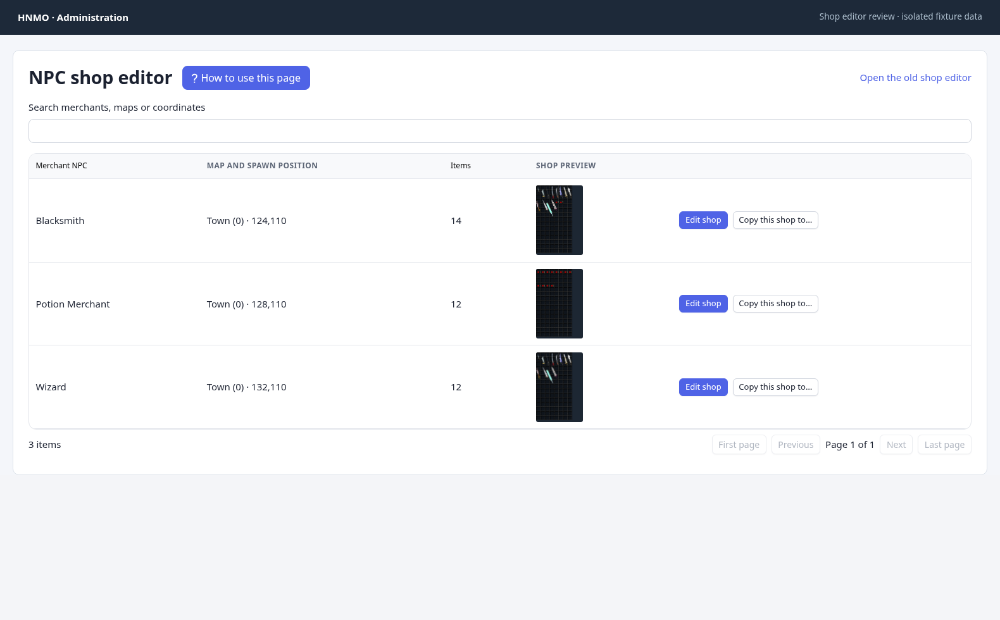
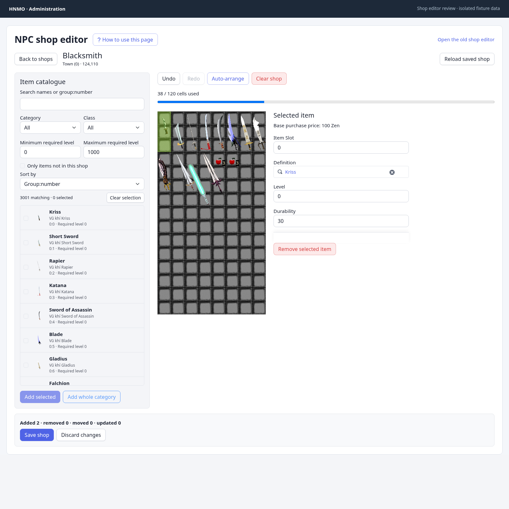

# Common tasks

Short recipes which combine several pages of the panel. Each step links to the
page with the details.

## Change the experience rate

1. Go to **Configuration → General** ([Game configuration](game-configuration.md#general)).
2. Change **Experience rate** (and **Master experience rate** if you want).
3. Save.
4. Click **Reload configuration and restart all game servers** on the
   [Servers page](servers.md).

The rate can also be set **per game server**, which is how you run one server
with different rates: open the game server on the
[Servers page](servers.md#editing-a-server) and change its experience rate there.

## Add a game server

1. [Servers page](servers.md#add-a-game-server) → **+ Game server**.
2. Fill in server id, description, experience rate, PvP, server configuration,
   client and network port.
3. Save, then start it in the server list.
4. Open the new port in your firewall/router and, in a docker deployment, publish
   it in the compose file. See [Ports](../reference/ports.md).

## Ban a player

1. If the player is online: disconnect them on the
   [Online accounts](online-accounts.md) page — or use **Temporarily ban** on the
   [live map](live-map.md), which does both at once.
2. Open the account on the [Accounts page](accounts.md) with **Edit**.
3. Set the **state** to `Banned` or `TemporarilyBanned` and save.

## Make somebody a game master

1. [Accounts page](accounts.md) → **Edit** the account.
2. Set the **state** to `GameMaster` (or `GameMasterInvisible`).
3. Save. The account can now use the game master
   [chat commands](chat-commands.md).

## Add a monster spawn

1. Go to **Configuration → Map editor** ([Map editor](map-editor.md)).
2. Select the map.
3. Click **+ Monster spawn area** and draw the area.
4. Set the monster, the quantity and the details of the focused object.
5. **Save**, then reload the configuration on the
   [Servers page](servers.md).

## Change a drop

1. Go to **Configuration → Item drops** ([Item drops](item-drops.md)).
2. Edit the group in its section — *Map drop groups*, *Monster drops* or
   *Item box drops* — or add a new one there.
3. For a map drop group, open its details and assign the maps where it should
   apply.
4. Check the result in the *Drop chance overview per monster*.
5. Save and reload the configuration.

## Switch to another game version

1. Go to the [Setup page](setup.md).
2. Click **Reinstall**, pick the game version, the number of game servers and
   whether test accounts should be created.
3. Click **Install** and wait.

:::danger[This deletes your data]
Reinstalling drops the existing database contents — accounts, characters and all
configuration changes. Back up your PostgreSQL database first.
:::

## Update HNMO to a newer version

1. Pull the new docker image (or build the new source) and restart the server.
2. Open the [Setup page](setup.md) — if it says *Update required*, run the schema
   update.
3. Open the [Configuration updates](configuration-updates.md) page and apply the
   available updates.
4. Restart the server process so the updates take effect.

## Fix "players get disconnected after selecting a server"

This is almost always the IP resolver reporting an address the client cannot
reach.

1. Go to **Configuration → System**
   ([System configuration](game-configuration.md#system)).
2. Set the **IP resolver**:
   * server and client on the same machine → `Loopback`
   * server in your LAN → `Local`
   * public server → `Public`, or `Custom` with your domain/IP
3. Save and restart the server process.

See [Connect a game client](../getting-started/game-client.md#disconnects-after-selecting-a-server).

## Turn a feature off

* A **chat command** → deactivate it on the
  [Chat commands](chat-commands.md) page.
* A **game mechanic implemented as a plugin** → deactivate it on the
  [Plugins](plugins.md) page.

## Reset the database

1. [Setup page](setup.md) → **Reinstall**.
2. Alternatively, start the server with the `-reinit`
   [start parameter](../deployment/startup-parameters.md).

For a throwaway test server, `-demo` starts the server with in-memory data which
is recreated at each start and never persisted.

## Limit gift-code claims by network or browser device

On **Gift codes**, edit a code and enable **One use per network address** and/or
**One use per device**. Both are off by default. The rules apply across game and
website claims, and across codes in the same batch. Accounts sharing an internet
address (for example a household or a gaming café) share the network allowance.
The two count columns include known identities recorded since this feature was
installed, even while limits are off; older redemptions cannot be backfilled.

The browser keeps a random device UUID on the same site for the game and account
page. Clearing storage or using another browser resets it. Older desktop clients
without an id are not device-limited; their connection address is still checked.
These limits deter repeated claims but cannot identify a unique person.

Only salted SHA-256 claims are saved, alongside a random secret in the existing
gift-code save file. Back up that file intact: deleting the secret or claims loses
identity history. The website bridge sets its own client-address header from the
TCP peer. The API accepts this header only from a loopback peer, consistent with
the game PROXY-line trust boundary. Keep `Relay:SendClientAddress` enabled for
game connections. Do not expose a local relay that passes
untrusted address headers through. A bridge on another computer is not trusted
by this implementation; the API uses its observed peer address instead. A front
proxy must preserve a trustworthy peer topology before deployment.

### Tiếng Việt

Trong **Gift code**, sửa mã rồi bật **Mỗi địa chỉ mạng chỉ được nhận một lần**
và/hoặc **Mỗi thiết bị chỉ được nhận một lần**. Mặc định cả hai đều tắt. Giới hạn
dùng chung cho game, website và các mã trong cùng lô. Những tài khoản dùng chung
mạng (như gia đình hoặc quán net) sẽ dùng chung hạn mức mạng. Hai cột thống kê chỉ
tính các danh tính đã ghi nhận từ khi cài tính năng, kể cả khi giới hạn tắt; không
thể bổ sung danh tính cho các lượt nhận cũ.

Trình duyệt lưu một mã thiết bị ngẫu nhiên, dùng chung cho game và trang tài khoản
trên cùng website. Xóa dữ liệu hoặc đổi trình duyệt sẽ đổi mã. Máy khách cũ không
có mã thiết bị không bị giới hạn theo thiết bị nhưng vẫn bị kiểm tra địa chỉ mạng.
Đây là biện pháp hạn chế nhận lặp, không phải cách xác định chính xác từng người.

Tệp lưu gift code chỉ giữ dữ liệu băm SHA-256 có khóa bí mật ngẫu nhiên; không lưu
địa chỉ mạng hoặc mã thiết bị thô. Hãy sao lưu nguyên tệp: xóa khóa hoặc dữ liệu
băm sẽ làm mất lịch sử danh tính. Bridge tự lấy địa chỉ từ kết nối và API chỉ tin
header này khi kết nối đến từ máy cục bộ. Bridge đặt ở máy khác chưa được tin cậy;
API sẽ dùng địa chỉ kết nối quan sát được. Giữ `Relay:SendClientAddress` bật cho
kết nối game. Cần kiểm tra cấu hình proxy thực tế
trước khi triển khai và không chuyển tiếp header địa chỉ do người dùng tự gửi.

## Edit an NPC shop

Open **Merchants** for the new shop editor. Search by NPC, map or coordinates,
then choose **Edit shop**. The old editor remains available through the link
next to the title. **How to use this page** explains the controls.

Search the catalogue by English or Vietnamese name, or `group:number`. Filter
by item group, character class and base required level; check **Only items not
in this shop** to avoid duplicates. The catalogue uses virtual scrolling.
Click an item for the first free position, drag it to a position, or tick several
and choose **Add selected**. **Add whole category** respects the active filters
and asks you to confirm how many items fit. Items that cannot fit are reported.

Select a grid item to edit its properties and view the server's base buying
price. Player taxes and price plugins can change the final amount. **Auto-arrange**
tries largest items first; if packing fails, the original layout is retained.
The grid is 8 × 15 cells. **Undo**, **Redo**, **Clear shop**, **Discard changes**
and copying from another merchant affect only the local draft until you save.
Undo history keeps the latest 100 steps.

**Save changes** asks you to confirm the added, removed, moved and updated counts.
It uses the existing configuration save path and logs the administrator and
counts. If another change conflicts, reload before editing again. Verify the
updated stock with a player on your running server. Fixed price overrides and
a shop multiplier are not implemented; NPC pricing needs additional server
model and purchase-rule changes.

Screenshots below use isolated sample data, not a live player database.

### Chỉnh sửa cửa hàng NPC

Mở **Thương nhân** để dùng trình sửa cửa hàng mới. Tìm theo NPC, bản đồ hoặc
tọa độ, rồi chọn **Sửa cửa hàng**. Liên kết cạnh tiêu đề vẫn mở được trình sửa
cũ. Nút **Hướng dẫn sử dụng trang này** giải thích các thao tác.

Tìm vật phẩm bằng tên tiếng Anh, tiếng Việt hoặc `nhóm:số`. Lọc theo nhóm,
lớp nhân vật và cấp yêu cầu cơ bản; bật bộ lọc chỉ hiện vật phẩm chưa có trong
cửa hàng nếu muốn tránh thêm trùng. Danh mục chỉ hiển thị những hàng đang xem
để cuộn nhanh. Bấm vật phẩm để đặt vào chỗ trống đầu tiên, kéo đến vị trí mong
muốn, hoặc đánh dấu nhiều vật phẩm rồi chọn thêm các mục đã chọn. Thêm cả nhóm
vẫn áp dụng các bộ lọc hiện tại và yêu cầu xác nhận số vật phẩm đặt vừa.
Các vật phẩm không đủ chỗ sẽ được thông báo rõ.

Chọn vật phẩm trong ô cửa hàng để sửa thuộc tính và xem giá mua cơ bản do máy
chủ tính. Thuế và phần mở rộng tính giá có thể làm thay đổi giá cuối cùng.
Tự sắp xếp thử đặt vật phẩm lớn trước; nếu không xếp hết được, bố cục cũ được
giữ nguyên. Cửa hàng có 8 × 15 ô. Hoàn tác, làm lại, xóa cửa hàng, bỏ thay đổi
và sao chép từ cửa hàng khác chỉ tác động đến bản nháp cho đến khi lưu.
Lịch sử hoàn tác giữ tối đa 100 bước gần nhất.

Khi lưu, kiểm tra số vật phẩm được thêm, xóa, di chuyển và chỉnh sửa trong hộp
xác nhận. Thay đổi được lưu theo cơ chế cấu hình hiện có; nhật ký ghi quản trị
viên và số lượng thay đổi. Nếu có xung đột, hãy tải lại trước khi sửa tiếp.
Kiểm tra hàng hóa mới bằng tài khoản người chơi trên máy chủ đang chạy. Chưa
hỗ trợ giá cố định riêng hoặc hệ số giá cả cửa hàng; các tính năng này cần
bổ sung mô hình dữ liệu và quy tắc mua hàng của máy chủ.
